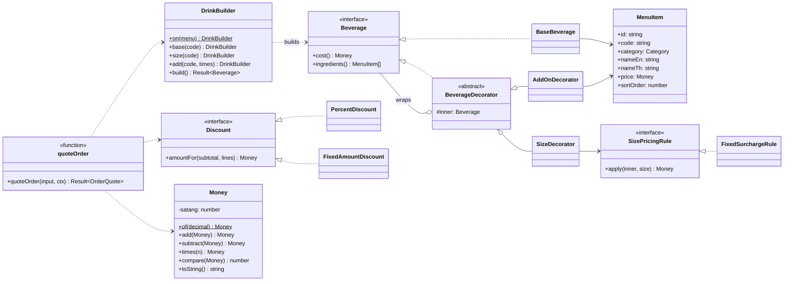

# Design — Customizable Coffee Shop (Staff POS)

This document describes **how** the system is built. **What** it must do is in [requirements.md](requirements.md); section references like "R§9" point there.

---

## 1. Deliverables map

The brief asks for five things. Each lives here:

| Brief asks for | Where |
|---|---|
| High-level class diagram / architecture | §3 Architecture, §4.6 Class diagram |
| Choice of language and why | §2 |
| A design that adds ingredients and computes prices dynamically **without excessive subclasses** | §4 Domain (Decorator + Strategy, data-driven menu) |
| Code snippets: create a base drink and customize it | §4.7 (the builder snippet is also in the README) |
| Benefits for maintainability and extensibility | §9 |

Submission: GitHub repository (zip as fallback), with the README as the entry point.

---

## 2. Language and stack

**TypeScript, end to end.**

- **One language, one domain package.** The pricing rules are written once in a pure TypeScript package and run in both the NestJS backend (authoritative) and the React frontend (live price and validation). Rules cannot drift between client and server.
- **Types catch money and state mistakes at compile time.** `Money` is a distinct type, not a `number`, so `price + 0.1` does not compile. Order and payment statuses are string-literal unions, so an impossible status is a type error.
- **Recommended by the brief**, and NestJS's module/DI system maps directly onto the domains (Menu, Order, Payment, Auth).

| Layer | Choice |
|---|---|
| Backend | NestJS, TypeORM (migrations, no `synchronize`), PostgreSQL |
| Auth | `@nestjs/jwt`, `@nestjs/passport`, bcrypt |
| Frontend | React + Vite, React Router, TanStack Query (server state), react-i18next, `qrcode.react` |
| Tests | Jest (domain, API), Supertest, Testcontainers (real PostgreSQL), Vitest + React Testing Library (web) |
| Runtime | Node.js LTS; Docker Compose for PostgreSQL, API and web |

TypeORM is 1.x and the Nest-family packages are pinned to v11 (v12 is ESM-only).

Configuration (see `.env.example`): `APP_ENV`, `DATABASE_URL`, `JWT_SECRET`, `WEB_ORIGIN`, `VAT_RATE_BPS`, `MAX_ADDONS`, `MAX_SAME_ADDON`, `MAX_CUPS`. The web app reads `VITE_API_URL` (default `http://localhost:3000`) at build time. Docker Compose runs the stack with `APP_ENV=dev`.

---

## 3. Architecture

### 3.1 Repository layout (npm workspaces monorepo)

```
.
├── packages/
│   └── domain/              # Pure TypeScript. No NestJS, React, or DB imports.
│       └── src/
│           ├── money/       # Money value object, rounding, VAT extraction
│           ├── menu/        # MenuItem, Menu, categories
│           ├── drink/       # Beverage, decorators, size pricing, DrinkBuilder and limits, describe
│           ├── discount/    # Discount strategies, preset resolution
│           ├── order/       # quoteOrder(), void reasons
│           ├── payment/     # cash rules
│           ├── time/        # Bangkok business date
│           ├── errors.ts    # error codes
│           └── index.ts     # The package's interface (see §4.1)
├── apps/
│   ├── api/                 # NestJS
│   │   └── src/
│   │       ├── auth/  menu/  discount/  order/  payment/  idempotency/   # module, controller, service, entities
│   │       ├── demo/        # dev-only demo orders (§5.7)
│   │       ├── common/      # error filter, Bangkok clock, config, money column transformer
│   │       └── database/    # data source, migrations (schema and seed data)
│   └── web/                 # React
│       └── src/
│           ├── pages/       # Login, Pos, Payment, Receipt, Orders
│           ├── features/    # cart (incl. discount), drink-builder, menu, orders, payment
│           ├── components/  # header, language switch, shared UI
│           ├── api/         # typed fetch client + TanStack Query hooks
│           └── locales/{en,th}/*.json
├── docs/
├── docker-compose.yml
└── README.md
```

### 3.2 Request flow

```
 React (apps/web)                         NestJS (apps/api)                     PostgreSQL
 ───────────────                          ─────────────────                     ──────────
 DrinkBuilder ─┐
 Cart ─────────┼─ quoteOrder() ◄─ packages/domain ─► quoteOrder() ─┐
               │  (live price,                       (authoritative)│
               │   validation)                                      │
               └── POST /orders ──────────────► OrderService ───────┴──► orders, order_lines,
                                                  │                        order_number_counters
                   POST /orders/:id/payments ──► PaymentService ─────────► payment_transactions
```

The **external seam** of the whole pricing problem is one pure function, `quoteOrder()` (§4.1). Both apps call it; neither re-implements a rule.

---

## 4. Domain (`packages/domain`)

### 4.1 Interface

The package is a **deep module**: callers learn a handful of exports, while composition, size pricing, description grouping, discounts, rounding, VAT and validation stay inside.

```ts
// Values
class Money { /* §4.2 */ }
type Lang = 'en' | 'th';

// Menu data in, Menu out
Menu.fromItems(items: MenuItemData[]): Menu

// Building one drink (used by snippets, tests, and quoteOrder internally)
DrinkBuilder.on(menu).base(code).size(code).add(code, times?).build(): Result<Beverage>

// The main seam: price a whole order
quoteOrder(input: OrderInput, ctx: QuoteContext): Result<OrderQuote>   // errors: DomainError[]

// Codes shared with the API and the i18n files
type ErrorCode = 'BASE_REQUIRED' | 'SIZE_REQUIRED' | /* … R§6, R§9, R§11 */ ;
```

```ts
interface OrderInput {
  lines: { base: string; size: string; addOns: { code: string; count: number }[]; quantity: number }[];
  discount?: { presetCode: string };   // staff-entered type/value/note: future (R§13.3)
}

interface DiscountPreset {
  id: string; code: string; nameEn: string; nameTh: string;
  type: 'PERCENT' | 'AMOUNT';
  value: string;               // "15.00" (percent) or "30.00" (baht)
  minSubtotal: string | null;  // "200.00"
}

interface QuoteContext {
  menu: Menu;
  presets: DiscountPreset[];   // active presets only; [] when the caller prices single lines
  vatRateBps: number;          // 700
  limits: { maxAddOns: number; maxSameAddOn: number; maxCups: number };   // 10, 5, 20 from config
}

interface OrderQuote {
  lines: QuotedLine[];         // descriptionEn/Th, unitPrice, lineTotal, quantity, components (with position)
  subtotal: Money;
  discount?: { preset: DiscountPreset; amount: Money };
  total: Money;                // subtotal − discount.amount
  vat: Money;
  beforeVat: Money;
  vatRateBps: number;
}
```

`quoteOrder` **returns** errors instead of throwing, so V7 ("reject the whole order and say which drink broke which rule") is just the error list: `{ line: 2, code: 'ADDON_REPEAT_LIMIT_EXCEEDED', params: { code: 'VANILLA', max: 5 } }`.

### 4.2 Money

- Internally an integer number of satang. Constructed from decimal strings (`Money.of('50.00')`) or satang (`Money.fromSatang(5000)`). Rejects more than 2 decimals.
- Operations: `add`, `subtract`, `times(n: integer)`, `compare`, `equals`, `isZero`.
- **One rounding function** for the whole system, `roundHalfUpDiv(numerator, denominator)` on `bigint`, used by percentage discounts (§4.4) and VAT. Intermediate products are computed exactly and rounded once.
- `toString()` → `"50.00"` for the API and DB; `format()` → `฿50.00` for display (the same in both languages).
- VAT: `extractVat(total, rateBps)` → `{ vat: roundHalfUpDiv(total × rate, 10000 + rate), beforeVat: total − vat }`.

### 4.3 Drink composition — Decorator

The brief's core problem: syrups and toppings combine freely and repeat, and new ones will appear. A subclass per combination (`CoffeeWithVanillaAndWhippedCream`) explodes; a subclass per ingredient (`VanillaDecorator`, `CaramelDecorator`, …) still grows with the menu.

The design uses the **Decorator** pattern with **data-driven decorators**: one decorator class for *all* add-ons, configured by a `MenuItem` loaded from the database.

```ts
interface Beverage {
  cost(): Money;
  ingredients(): readonly MenuItem[];   // base first, then everything wrapped around it
}

class BaseBeverage implements Beverage {           // Coffee, Tea, Milk, Latte… (data)
  constructor(private readonly base: MenuItem) {}
  cost() { return this.base.price; }
  ingredients() { return [this.base]; }
}

abstract class BeverageDecorator implements Beverage {
  constructor(protected readonly inner: Beverage) {}
  abstract cost(): Money;
  ingredients() { return this.inner.ingredients(); }
}

class AddOnDecorator extends BeverageDecorator {   // every extra, syrup, topping (data)
  constructor(inner: Beverage, private readonly addOn: MenuItem) { super(inner); }
  cost() { return this.inner.cost().add(this.addOn.price); }
  ingredients() { return [...this.inner.ingredients(), this.addOn]; }
}

class SizeDecorator extends BeverageDecorator {    // always the outermost layer
  constructor(inner: Beverage, private readonly size: MenuItem,
              private readonly rule: SizePricingRule) { super(inner); }
  cost() { return this.rule.apply(this.inner.cost(), this.size); }
  ingredients() { return [...this.inner.ingredients(), this.size]; }
}
```

**Class count is fixed at three**, whatever the menu holds. "Double vanilla" is simply two `AddOnDecorator` layers. A new syrup is a database row.

Size is the outermost decorator so its pricing rule sees the full price of everything inside it. That is what makes R§13.2's "size as multiplier" a one-class change.

### 4.4 Strategies

| Seam | Interface | Adapters | Why it is a seam |
|---|---|---|---|
| Size pricing | `SizePricingRule.apply(inner: Money, size: MenuItem): Money` | `FixedSurchargeRule` (today: `inner + size.price`) | Required by R§13.1. One adapter today, so this seam is *hypothetical*; it costs one small interface and is documented as such. |
| Discount | `Discount.amountFor(subtotal: Money, lines: QuotedLine[]): Money` | `PercentDiscount` (value in basis points, `roundHalfUpDiv(subtotal × bps, 10000)`, the same rounding as VAT), `FixedAmountDiscount`; future `BuyXGetYDiscount` | Two adapters today, a real seam. `lines` is passed so Buy X Get Y (cheapest cup free) needs no interface change. |

**Preset resolution** (`packages/domain/src/discount/`) turns a `DiscountPreset` row into a `Discount` and checks it against the subtotal. It runs inside `quoteOrder` only after every line is valid, because it needs the subtotal:

1. No `input.discount` → no discount, `total = subtotal`.
2. `presetCode` not in `ctx.presets` (unknown or inactive) → `DISCOUNT_PRESET_UNAVAILABLE`.
3. `subtotal < minSubtotal` → `DISCOUNT_MIN_SPEND_NOT_MET` with `params.minSubtotal`.
4. `amount = min(discount.amountFor(subtotal, lines), subtotal)`; the cap is a guard, since no seeded preset can exceed its own minimum spend.

`isPresetEligible(preset, subtotal): boolean` (rule 3 alone) is exported so the cart greys out presets with the same rule the server applies. Staff-entered values (value range, note) are future work (R§13.3); they would add a resolution step, not a new interface.

### 4.5 Description

`describe(beverage, lang)` reads `ingredients()`, never the decorator chain's own strings, because the required format is not a simple concatenation:

1. Head: `"<Size> <Base>"` in English, `"<Base> <Size>"` in Thai.
2. Add-ons grouped by category in the fixed order **EXTRA → SYRUP → TOPPING**.
3. Within a group, sorted by menu `sortOrder` (click order is irrelevant, R§5).
4. Repeats collapsed as `Nx Name` in both languages.

It also returns each add-on's `position`, which the API stores in the order snapshot so reprints never change. Identical recipes therefore yield identical descriptions, which is also the cart's merge key.

### 4.6 Class diagram



### 4.7 Snippets: create a base drink and customize it

```ts
import {
  Menu, DrinkBuilder, describe, quoteOrder, DEFAULT_LIMITS,
  BaseBeverage, AddOnDecorator, SizeDecorator, FixedSurchargeRule,
  type Beverage,
} from '@coffee/domain';

const menu = Menu.fromItems(rowsFromDatabase);

const drink = DrinkBuilder.on(menu)
  .base('COFFEE')
  .size('SIZE_LARGE')
  .add('VANILLA', 2)          // double vanilla
  .add('WHIPPED_CREAM')
  .build()
  .unwrap();

drink.cost().toString();      // "115.00"   = 50 + 30 + 10 + 10 + 15
describe(drink, 'en');        // "Large Coffee, 2x Vanilla, Whipped Cream"
describe(drink, 'th');        // "กาแฟ แก้วใหญ่, 2x วานิลลา, วิปครีม"
```

The same drink composed by hand, showing the decorator layers the builder creates (`menu.get()` returns `undefined` for an unknown code, hence the `!`):

```ts
let beverage: Beverage = new BaseBeverage(menu.get('COFFEE')!);
beverage = new AddOnDecorator(beverage, menu.get('VANILLA')!);
beverage = new AddOnDecorator(beverage, menu.get('VANILLA')!);
beverage = new AddOnDecorator(beverage, menu.get('WHIPPED_CREAM')!);
beverage = new SizeDecorator(beverage, menu.get('SIZE_LARGE')!, new FixedSurchargeRule());
beverage.cost().toString();   // "115.00"
```

Adding a brand-new ingredient needs **no code**:

```sql
INSERT INTO menu_items (code, category, name_en, name_th, price, sort_order)
VALUES ('HAZELNUT', 'SYRUP', 'Hazelnut', 'เฮเซลนัท', 12.00, 4);
```

Pricing a whole order with a discount preset (subtotal -> discount -> total -> VAT on the total):

```ts
const quote = quoteOrder(
  {
    lines: [
      { base: 'TEA', size: 'SIZE_MEDIUM', addOns: [], quantity: 2 },
      { base: 'COFFEE', size: 'SIZE_LARGE', addOns: [{ code: 'VANILLA', count: 1 }], quantity: 1 },
    ],
    discount: { presetCode: 'PROMO_10_PERCENT' },
  },
  { menu, vatRateBps: 700, limits: DEFAULT_LIMITS, presets: presetsFromDatabase },
).unwrap();

quote.subtotal.toString();          // "200.00"
quote.discount?.amount.toString();  // "20.00"   (10%, half-up, never above the subtotal)
quote.total.toString();             // "180.00"  (VAT is included in prices)
quote.vat.toString();               // "11.78"   (extracted from the discounted total)
quote.beforeVat.toString();         // "168.22"
```

---

## 5. Backend (`apps/api`)

### 5.1 Modules

| Nest module | Responsibility | Talks to |
|---|---|---|
| `AuthModule` | `POST /auth/login`, JWT strategy, global guard (public routes opt out; the token's staff must still exist) | `staff` |
| `MenuModule` | `GET /menu`; builds `Menu` for other modules | `menu_items` |
| `DiscountModule` | `GET /discount-presets` | `discount_presets` |
| `OrderModule` | Place, list, get, void | domain `quoteOrder`, `OrderNumberAllocator`, `orders`, `order_lines`, `order_line_items` |
| `PaymentModule` | Start payment (QR/cash), get, mock-confirm | `QrPaymentProvider`, `payment_transactions` |
| `IdempotencyModule` | Interceptor for `Idempotency-Key` | `idempotency_keys` |
| `common` | Error filter (domain codes → HTTP), Bangkok clock, typed config (`APP_ENV`, `VAT_RATE_BPS`, limits) | — |

Controllers stay thin: parse, call one service method, map the result.

### 5.2 Placing an order

`OrderService.place(staffId, input)` runs in **one DB transaction**:

1. Load active menu items and presets → `Menu`, `DiscountPreset[]`.
2. `quoteOrder(input, ctx)`. Errors → HTTP 400 `VALIDATION_FAILED` with details. Nothing is written.
3. `OrderNumberAllocator.next(businessDate)`:
   ```sql
   INSERT INTO order_number_counters (business_date, last_value) VALUES ($1, 1)
   ON CONFLICT (business_date) DO UPDATE SET last_value = order_number_counters.last_value + 1
   RETURNING last_value;
   ```
   Atomic under concurrency; formatted `YYYYMMDD-` + `padStart(4, '0')` (widens to 5 digits naturally past 9999). The row lock is held only until commit.
4. Insert `orders`, `order_lines`, `order_line_items` from the quote (snapshots, `position`).
5. Commit and return the order DTO.

A seeded preset cannot bring the total to zero (R§9.1), so every order starts `PENDING_PAYMENT`. Free orders (a `NONE` transaction and `PAID` at placement) are future work (R§13.3).

`businessDate` comes from an injected `Clock` returning the Asia/Bangkok date, so tests can pin the date.

### 5.3 State changes and locking

Pay, mock-confirm and void each begin with `SELECT … FROM orders WHERE id = $1 FOR UPDATE`, then check the status and act. A second terminal waits on the lock, then sees the new status and fails with `ORDER_NOT_PAYABLE` / `VOID_NOT_ALLOWED` (R§10.1a).

Database constraints back the invariants (R§11), so a bug cannot break them silently:
- Partial unique index: one `SUCCEEDED` transaction per order.
- Partial unique index: one `PENDING` transaction per order.

### 5.4 Payments

```ts
interface QrPaymentProvider {
  createQr(orderId: string, amount: Money, expiresAt: Date): Promise<{ qrPayload: string; providerRef: string }>;
}
```

- `MockQrProvider` is the only adapter (a hypothetical seam, kept because R§11.1 documents a real provider as the next step).
- Starting a payment expires any existing `PENDING` transaction for the order first.
- **QR expiry on access:** `PaymentService` checks `now > expiresAt` whenever it loads a transaction; if so it sets `EXPIRED` and, on confirm, fails with `PAYMENT_EXPIRED`.
- **Cash** needs no provider: validate amount, compute change, write a `SUCCEEDED` transaction, set the order `PAID`.
- `mock-confirm` is always registered but guarded by `DevOnlyGuard`, which answers 404 `NOT_FOUND` when `APP_ENV` is not `dev`, so in `prod` it is indistinguishable from a missing route. The global JWT guard runs first, so an unauthenticated request gets 401 before the 404.
- Every transaction stores `processedByStaffId` from the JWT.

### 5.5 Idempotency

An interceptor on `POST /orders`, `POST /orders/:id/payments`, `POST /payments/:id/mock-confirm` and `POST /orders/:id/void`:

1. Reads `Idempotency-Key` (required on these routes; the web client generates a UUID per user action).
2. Inserts `(staffId, key, requestHash, status='IN_PROGRESS')`. The primary key makes a concurrent duplicate fail fast → `409 IDEMPOTENCY_IN_PROGRESS`.
3. If the key exists: same hash and completed → replay the stored response; different hash → `422 IDEMPOTENCY_KEY_REUSED`.
4. On success, stores the status code and body. Keys older than 24 hours may be purged (no purge job exists yet).
5. If the handler fails, the interceptor deletes the key so the client can retry with the same key. If the handler succeeded but storing the completed response fails, the key stays `IN_PROGRESS`, so a retry gets `409 IDEMPOTENCY_IN_PROGRESS` rather than running the action twice.

### 5.6 Errors

```json
{
  "error": {
    "code": "VALIDATION_FAILED",
    "details": [
      { "line": 1, "code": "ADDON_REPEAT_LIMIT_EXCEEDED", "params": { "code": "VANILLA", "max": 5 } },
      { "code": "DISCOUNT_MIN_SPEND_NOT_MET", "params": { "minSubtotal": "200.00" } }
    ]
  }
}
```

| HTTP | Codes |
|---|---|
| 400 | `VALIDATION_FAILED` (details carry V1–V6, discount and cash codes) |
| 401 | `UNAUTHORIZED`, `INVALID_CREDENTIALS` |
| 404 | `NOT_FOUND` (also mock-confirm in prod) |
| 409 | `ORDER_NOT_PAYABLE`, `VOID_NOT_ALLOWED`, `PAYMENT_EXPIRED`, `IDEMPOTENCY_IN_PROGRESS` |
| 422 | `IDEMPOTENCY_KEY_REUSED` |

Messages are never sent; the web app translates codes (`error-message-code.json`).

### 5.7 Demo orders (R§10.3)

`apps/api/src/demo/`:

- `demo-orders.ts`: the sample orders as data (cart, discount preset, staff, outcome: `CASH`, `QR`, `PENDING` or a void reason), and `seedDemoOrders(app, clock, now)`.
- `seed-demo.ts`: the command line entry (`npm run seed:demo` → `node dist/demo/seed-demo.js`).

`seedDemoOrders` throws unless `APP_ENV=dev` and returns `{ skipped: true }` if `orders` has any row. For each sample order, oldest first, it sets the clock to the order's time and calls `OrderService.place`. It then moves the clock forward a little and calls `PaymentService.start` (cash, or QR followed by `mockConfirm`) or `OrderService.void`. Going through the services instead of writing rows keeps order numbers, snapshots, discounts, VAT and change computed by the same code as a real order. No HTTP is involved, so idempotency keys play no part.

The clock is a `FixedClock` (`common/clock.ts`, shared with the test harness). The command builds a Nest application context from a small `SeedDemoModule`: the database, `PaymentModule` (which brings `OrderModule`, `MenuModule` and `DiscountModule`), and a global module providing `CONFIG` and that `FixedClock` in place of `CommonModule`'s `SystemClock`. A Nest application context cannot override a provider, so the command uses its own module rather than `AppModule`.

In Docker the API container's start command runs the seed between the migrations and the server when `SEED_DEMO=true`, which `docker-compose.yml` sets.

### 5.8 Security headers and containers

- **API:** `configureApp` (shared by `main.ts` and the test harness) turns off `X-Powered-By` and applies `helmet`. The API serves JSON only, so its CSP is `default-src 'none'; frame-ancestors 'none'` and `X-Frame-Options` is `DENY`; helmet's other defaults (`nosniff`, HSTS, `Referrer-Policy`, …) stay on. CORS still allows only `WEB_ORIGIN`.
- **Web:** `apps/web/nginx.conf.template` sets `server_tokens off`, `X-Content-Type-Options`, `X-Frame-Options: DENY`, `Referrer-Policy: no-referrer` and a CSP that allows only the app's own files plus `data:` images and fonts (Vite inlines small assets) and lets it call the API: `connect-src 'self' ${API_ORIGIN}`. The nginx image fills in `API_ORIGIN` from the environment at start; the web Dockerfile defaults it to the `VITE_API_URL` the app was built with.
- **Containers:** the API runs as the node image's `node` user; the web runs on `nginxinc/nginx-unprivileged` (uid 101). Neither runs as root.

What is deliberately left out and what a production deployment still needs is listed in the README's Security section.

---

## 6. Database schema

All money columns are `numeric(12,2)` mapped to `Money` by a TypeORM column transformer. All ids are `uuid`. All timestamps are `timestamptz`.

```
staff
  id PK · username UNIQUE · password_hash · display_name · is_active · created_at

menu_items
  id PK · code UNIQUE (immutable) · category enum(BASE,SIZE,EXTRA,SYRUP,TOPPING)
  name_en · name_th · price · is_active · sort_order · created_at · updated_at

discount_presets
  id PK · code UNIQUE · name_en · name_th · type enum(PERCENT,AMOUNT)
  value CHECK (> 0; ≤ 100 when PERCENT) · min_subtotal NULL · is_active · sort_order · created_at
  -- type and value are immutable after insert: a BEFORE UPDATE trigger raises if either changes

order_number_counters
  business_date PK · last_value

orders
  id PK · order_number UNIQUE · business_date · status enum(PENDING_PAYMENT,PAID,VOIDED)
  created_by_staff_id FK · created_at
  subtotal · discount_preset_id FK NULL · discount_amount DEFAULT 0
  total · vat_rate_bps · vat · before_vat
  -- staff-entered discounts would add discount_type, discount_value, discount_note (R§13.3)
  voided_at NULL · voided_by_staff_id FK NULL · void_reason_code NULL · void_reason_note NULL
  INDEX (business_date, status) · INDEX (created_at)

order_lines
  id PK · order_id FK · line_no · quantity · unit_price · line_total
  description_en · description_th            -- rendered at order time

order_line_items                             -- the snapshot of one drink's components
  id PK · order_line_id FK · menu_item_id FK · code · category · name_en · name_th
  unit_price · count · position              -- BASE and SIZE have count 1

payment_transactions
  id PK · order_id FK · method enum(QR,CASH,NONE) · amount
  status enum(PENDING,SUCCEEDED,FAILED,EXPIRED)
  qr_payload NULL · provider_ref NULL · cash_received NULL · change NULL
  processed_by_staff_id FK · created_at · completed_at NULL · expires_at NULL
  UNIQUE (order_id) WHERE status = 'SUCCEEDED'
  UNIQUE (order_id) WHERE status = 'PENDING'

idempotency_keys
  PK (staff_id, key) · request_hash · status · response_code NULL · response_body jsonb NULL · created_at
```

Rendered descriptions are stored as well as the components: reprints show exactly what was printed, and components remain queryable for future reporting.

---

## 7. HTTP interface

All bodies are JSON; money is a decimal string. Every route except `POST /auth/login` and `GET /menu` requires `Authorization: Bearer <jwt>`. Routes marked **(idem)** require `Idempotency-Key`.

| Method & path | Body / query | Returns |
|---|---|---|
| `POST /auth/login` | `{ username, password }` | `{ accessToken, staff: { id, displayName }, appEnv: 'dev' \| 'prod' }` |
| `GET /menu` | — | `{ items: [{ id, code, category, nameEn, nameTh, price, sortOrder }] }` |
| `GET /discount-presets` | — | `{ presets: [{ id, code, nameEn, nameTh, type, value, minSubtotal }] }` (active only, by `sort_order`) |
| `POST /orders` (idem) | `OrderInput` (§4.1) | `201` Order |
| `GET /orders` | `date=YYYY-MM-DD` (today … −7 days), `status`, `method`, `sort=asc\|desc` | `{ orders: OrderSummary[] }` |
| `GET /orders/:id` | — | Order (with transactions) |
| `POST /orders/:id/void` (idem) | `{ reasonCode, note? }` | Order |
| `POST /orders/:id/payments` (idem) | `{ method: 'QR' }` or `{ method: 'CASH', cashReceived: '200.00' }` | `{ transaction, order }` |
| `GET /payments/:id` | — | `{ transaction, order }` (expiry evaluated) |
| `POST /payments/:id/mock-confirm` (idem, dev only) | — | `{ transaction, order }` |

Order response (abridged):

```json
{
  "id": "6f1c…",
  "orderNumber": "20261021-0001",
  "status": "PENDING_PAYMENT",
  "createdAt": "2026-10-21T07:05:00Z",
  "createdBy": { "id": "…", "displayName": "Cashier 1" },
  "lines": [
    { "quantity": 2, "descriptionEn": "Medium Tea", "descriptionTh": "ชา แก้วกลาง", "unitPrice": "55.00", "lineTotal": "110.00" },
    { "quantity": 1, "descriptionEn": "Large Coffee, Vanilla", "descriptionTh": "กาแฟ แก้วใหญ่, วานิลลา", "unitPrice": "90.00", "lineTotal": "90.00" }
  ],
  "subtotal": "200.00",
  "discount": { "presetCode": "PROMO_10_PERCENT", "nameEn": "Promotion 10%", "nameTh": "โปรโมชัน ลด 10%", "amount": "20.00" },
  "total": "180.00",
  "vatRateBps": 700,
  "vat": "11.78",
  "beforeVat": "168.22",
  "transactions": []
}
```

The discount name in the response is joined from `discount_presets` (preset names are not snapshotted, per R§9.2). An order without a discount has `"discount": null`. Order summaries (`GET /orders`) do not carry the discount.

Examples with `curl` (stack running, `jq` and `uuidgen` installed; `$ORDER_ID` comes from a placed order):

```bash
TOKEN=$(curl -s localhost:3000/auth/login -H 'Content-Type: application/json' \
  -d '{"username":"cashier1","password":"password123"}' | jq -r .accessToken)

# active discount presets
curl -s localhost:3000/discount-presets -H "Authorization: Bearer $TOKEN"

# place an order with a discount
curl -s localhost:3000/orders \
  -H "Authorization: Bearer $TOKEN" -H 'Content-Type: application/json' \
  -H "Idempotency-Key: $(uuidgen)" \
  -d '{"lines":[{"base":"TEA","size":"SIZE_MEDIUM","addOns":[],"quantity":2},{"base":"COFFEE","size":"SIZE_LARGE","addOns":[{"code":"VANILLA","count":1}],"quantity":1}],"discount":{"presetCode":"PROMO_10_PERCENT"}}'

# pay order $ORDER_ID with cash
curl -s localhost:3000/orders/$ORDER_ID/payments \
  -H "Authorization: Bearer $TOKEN" -H 'Content-Type: application/json' \
  -H "Idempotency-Key: $(uuidgen)" \
  -d '{"method":"CASH","cashReceived":"250.00"}'

# void an unpaid order
curl -s localhost:3000/orders/$ORDER_ID/void \
  -H "Authorization: Bearer $TOKEN" -H 'Content-Type: application/json' \
  -H "Idempotency-Key: $(uuidgen)" \
  -d '{"reasonCode":"CUSTOMER_CHANGED_MIND"}'

# today's paid cash orders
curl -s "localhost:3000/orders?status=PAID&method=CASH" -H "Authorization: Bearer $TOKEN"
```

---

## 8. Frontend (`apps/web`)

- **Server state** (menu, presets, orders, payments) via TanStack Query; **cart** is a reducer persisted to localStorage (R§7).
- The drink builder and cart call the domain's `DrinkBuilder` / `quoteOrder` with the fetched menu, so limits, remarks, greyed presets and live totals use the same code as the server.
- The cart merge key is the drink's English description (identical recipe ⇔ identical description, §4.5).
- Discount: the chosen `presetCode` lives in `useCart` beside the lines and is stored under its own localStorage key (`pos.cart.discount`), so the stored line format does not change. The dropdown disables presets that fail `isPresetEligible` and shows "Min. spend ฿…". When cart changes make the chosen preset ineligible, the cart drops it and shows a notice (R§7). A server `DISCOUNT_PRESET_UNAVAILABLE` (preset retired meanwhile) shows the translated error and refetches the presets. Placing an order clears the discount with the cart.
- Payment screen: QR via `qrcode.react` with a client-side countdown from `expiresAt`; the "Simulate customer paid" button renders only when the login response reports `appEnv: 'dev'` (the server enforces it regardless). Cash shows change as staff type.
- Receipt uses a print stylesheet and `window.print()`.
- Idempotency keys: one UUID per user action, reused on retry of that action.
- i18n as in R§15. A test asserts every `ErrorCode` exported by the domain has a translation in both `en/error-message-code.json` and `th/error-message-code.json`.

---

## 9. Why this design

**Maintainability (locality)**
- Every pricing rule lives in `packages/domain`. A rounding fix or a new limit is changed once and is correct on the server, in the live cart, and in tests.
- `Money` owns rounding, so "how many decimals" and "which rounding" are answered in one file.
- Controllers and React components contain no business rules; they can be read without knowing VAT or discount logic.
- Snapshots make orders immutable history: menu edits never require migrating old orders.

**Extensibility (leverage)**
- New ingredient: one row, zero classes (Decorator with data-driven `AddOnDecorator`).
- New category: one enum value and its description position.
- New discount type: one `Discount` class; `quoteOrder`'s interface unchanged.
- New size pricing: one `SizePricingRule` class.
- Real QR provider: one `QrPaymentProvider` adapter plus a webhook route.

**Testability**
- `quoteOrder` is pure: the R§16 acceptance examples run as plain unit tests with no DB or HTTP.
- Side effects sit behind injected seams (`Clock`, `QrPaymentProvider`, repositories), so API tests can pin time and run against a real PostgreSQL.

**Trade-offs, stated honestly**
- The Decorator chain prices well but cannot produce the required grouped description by itself; `describe()` works from `ingredients()` instead. The chain is kept because it makes "any number of add-ons, repeats allowed" structural, and it is the pattern the brief points to.
- `SizePricingRule` and `QrPaymentProvider` have one adapter each, so they are hypothetical seams kept on purpose for documented next steps (R§13.2, R§11.1).

---

## 10. Testing map

| Requirement area | Test location | Kind |
|---|---|---|
| Money, rounding, VAT (A2, A3, A4, A7) | `packages/domain/money`, `order` | Unit, TDD |
| Composition, description EN/TH, merge key (A1, A15) | `packages/domain/drink` | Unit, TDD |
| Validation V1–V6 (A8–A10), discounts (A3–A7) | `packages/domain/order`, `discount` | Unit, TDD |
| Order numbers under concurrency (A13), idempotency (A16), pay/void race (A17) | `apps/api/test` | Supertest + Testcontainers |
| QR expiry (A18), mock in prod (A19), cash (A11, A20), void (A12), snapshot (A14) | `apps/api/test` | Supertest + Testcontainers |
| Builder limits, cart, presets, payment screen, language switch | `apps/web` | Vitest + RTL |
| i18n key parity, error-code coverage | `apps/web` | Vitest |

---

## 11. Delivery phases

Cross-cutting concerns are built with the core because retrofitting them touches finished work. Feature additions come later because the seams above let them slot in without rework.

| Phase | Scope | Notes |
|---|---|---|
| **1 — Core (answers the brief, shippable)** | Domain: `Money`, menu, decorators, EN/TH description, V1–V6, VAT, `quoteOrder` (TDD). API: `/auth/login`, `/menu`, `POST /orders` and `GET /orders/:id` with order numbers and snapshots (the `GET /orders` list moves to phase 2 with the Orders page). Web: login, POS (builder + cart), receipt, language switch. README with the brief's deliverables. | VAT, auth and i18n are in the core: VAT shapes the order schema and receipt; auth supplies the required `created_by_staff_id` and wraps every route and API call; i18n avoids rewriting hard-coded strings. Orders stay `PENDING_PAYMENT`. Double submits are prevented by disabling the button while sending. |
| **2 — Payment** | Cash, mock QR, void, Orders page with filters, row locking, idempotency | Grouped because they are all money/state operations where duplicates and races cause real harm. |
| **3 — Discount** | Fixed-value presets (`STAFF_15`, `PROMO_10_PERCENT`, `PROMO_30_BAHT`) with min spend: domain strategies, `discount_presets` + immutability trigger, `GET /discount-presets`, discount on `POST /orders` and the order DTO, cart dropdown with greyed presets and auto-removal, receipt line, EN/TH | `quoteOrder` already has the subtotal → discount → total → VAT pipeline with discount = 0, and `OrderInput.discount` is optional, so its interface does not change. Staff-entered values and free orders are deferred (R§13.3, decisions #57); the `NONE` payment method they need already exists from phase 2. |
